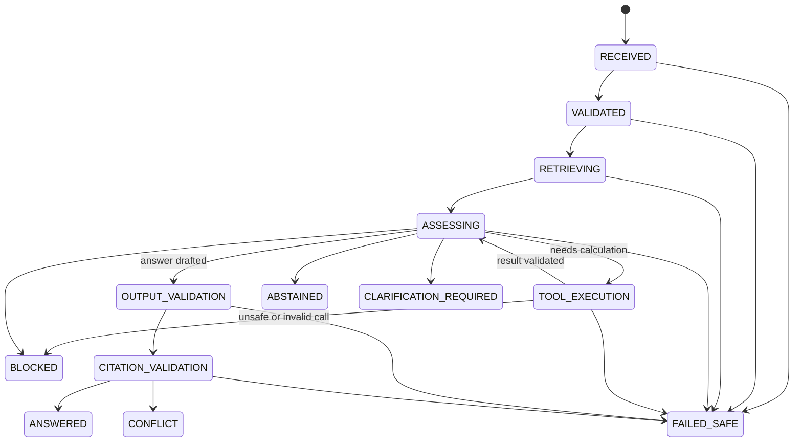

# 5. Agentic and Tool-Using Workflow

> Assignment §5: one purposeful workflow where the model selects or sequences tools; deterministic code for calculations; visible state transitions, tool inputs and outputs, stopping conditions, retry limits and recovery from a tool failure; a justification for using an agent.

## What the agent does

For each question the host first retrieves and verifies evidence. The model then decides whether the question also needs a calculation, and if so builds a typed `query_statistics` request, for example "mean youth unemployment, India, 2020–2022". The model cannot do arithmetic: the tool returns the rows, the formula, the rounding rule and the result, and the host renders the final calculation text from those validated rows.

Retrieval is a **host step**, not a model-chosen tool. The model's only tool is `query_statistics`. This keeps the agent surface minimal: it can neither choose what to read nor reach any other capability.

## Why an agent, and why bounded

| Question | Answer |
|---|---|
| Why not a fixed pipeline? | Whether a question needs a calculation, which countries and years to query, and whether to batch them varies by question. A fixed workflow either always calls the tool (waste, and wrong for text-only questions) or never does. |
| Evidence the agent helps | On the 67 cases the agent scores 0.866 against 0.433 for the non-agent baseline. On `structured_unstructured_synthesis` it scores 1.000 against 0.000 and on `multi_source_synthesis` 0.667 against 0.000; on `multi_step_tool` the agent scores 0.667 against 1.000 (n=3, one agent failure was a citation fail-safe) ([experiments](04-genai-experiments.md)). The baseline has no tool, so gains on tool categories are expected. |
| Why not multi-agent? | One model, one read-only tool and a hard budget is enough, and it is easier to audit. More agents would add failure modes without measured benefit. |
| Honest limit | A deterministic router could handle the simplest calculation cases. The agent earns its place on multi-step and synthesis questions, which have few cases (3 each). |

## State machine

`AgentRunLedger` (`agent_runtime/state.py`) allows only the transitions above. Skipping a state raises an error. Each transition and tool step emits a safe lifecycle event with a trace ID, duration, tool name and error code but never prompt text, tool arguments or hidden reasoning. The UI shows these events per answer as the activity trail.

Terminal states: `ANSWERED`, `ABSTAINED`, `CLARIFICATION_REQUIRED`, `CONFLICT`, `BLOCKED`, `FAILED_SAFE`.

## Bounds and stopping conditions

| Limit | Value | Setting |
|---|---|---|
| Model turns | 6 | `MAX_AGENT_TURNS` |
| Tool calls per run | 8 | `MAX_TOOL_CALLS` |
| Calls per tool | 4 | `MAX_TOOL_CALLS_PER_TOOL` |
| Retries | 1, transient errors only (`MCP_UNAVAILABLE`, `MCP_TIMEOUT`, `INTERNAL_ERROR`) | `MAX_TOOL_RETRIES` |
| MCP call timeout | 15 s | `MCP_TIMEOUT_SECONDS` |
| Request deadline | 90 s | `REQUEST_TIMEOUT_SECONDS` |
| Output | 1,200 tokens | `MAX_AGENT_OUTPUT_TOKENS` |

Further rules: identical tool calls in a run are served from a run cache, so retries are idempotent. Invalid arguments and malformed output are **never** retried. A citation failure is repaired at most once, and a second failure ends as `failed_safe`. If retrieval returns nothing, the run abstains without calling the provider.

## Tool contract

`query_statistics` (served over MCP, see [MCP](09-mcp-integration.md)): request `schema_version`, `indicator` (youth `SL.UEM.1524.ZS` or total `SL.UEM.TOTL.ZS`), 1–4 ISO3 `geographies`, `start_year`/`end_year` within 2015–2025, `aggregation` (`none`, `mean`, `sum`, `median`), `group_by` (`geography`, `year`) and `row_limit` ≤ 44. The result contains rows with unit and observation status, a calculation with formula and rounding, row keys as evidence, and source attribution. Errors use a fixed code set such as `STATISTICS_RANGE_INVALID`.

## Failure recovery: observed behaviour

These come from the stored [run `ad3163da…`](06-evaluation-analysis.md). The MCP faults were produced by a synthetic fault-injection wrapper (`agent_runtime/fault_injection.py`) around the real adapter, because live runs cannot trigger them.

| Failure | System behaviour | Result |
|---|---|---|
| MCP timeout (3 cases) | One bounded retry, then `failed_safe` with `MCP_TIMEOUT`. No fallback to the model's own numbers. | All 3 scored as expected. |
| Malformed tool response (3 cases) | Not retried. `failed_safe` with `TOOL_MALFORMED_RESPONSE`. | All 3 scored as expected. |
| Retrieval returns nothing | Abstain without a model call. | Unit-tested. |
| Citation does not match evidence | One repair attempt, then `failed_safe` (`CITATION_INVALID`). | One real failure: `structured-unstructured-singapore-tripartite-total`. |
| Tool budget exhausted | `failed_safe` (`TOOL_BUDGET_EXCEEDED`). | One real failure: `multi-step-indonesia-youth-period-change`. |

Fail-safe here means "stop and say so", which scores as the expected behaviour for injected faults. It does not mean the question was answered. The two real failures above are lost answers, discussed in [evaluation analysis](06-evaluation-analysis.md).

Tests: `apps/backend/tests/unit/test_agent_state.py`, `test_agent_tools.py`, `test_agent_runtime.py`.
