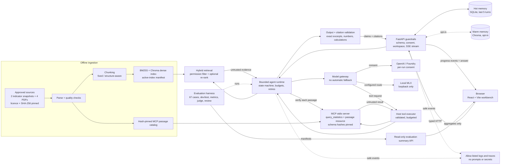

# PolicyLens Architecture Diagram

The diagram shows the offline pipeline and the per-request flow. Retrieval is a host step, not a model-selected tool; the model can only request the allow-listed statistics tool. Agent state and citation lookup are request-scoped; persistence is the job of hot and warm memory. Retrieved passages and MCP output are untrusted data. OpenAI processing needs explicit per-run approval, MLX is loopback-only, and no provider fallback occurs.
