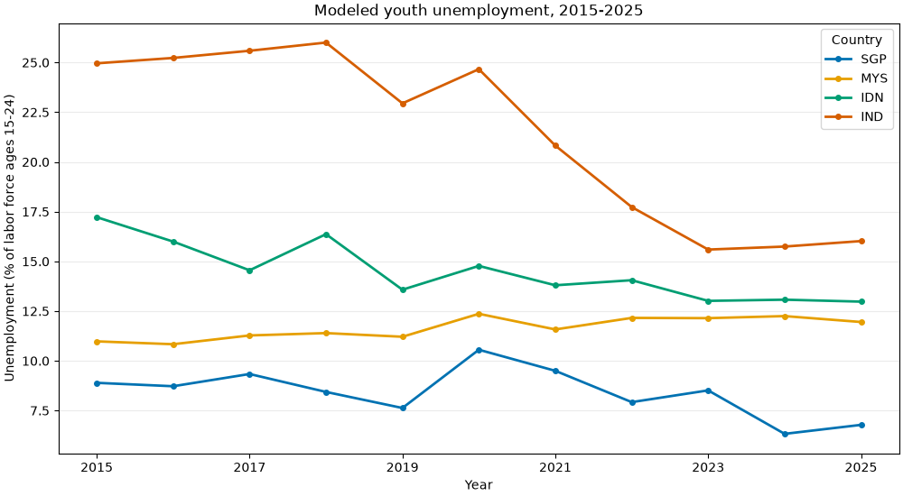
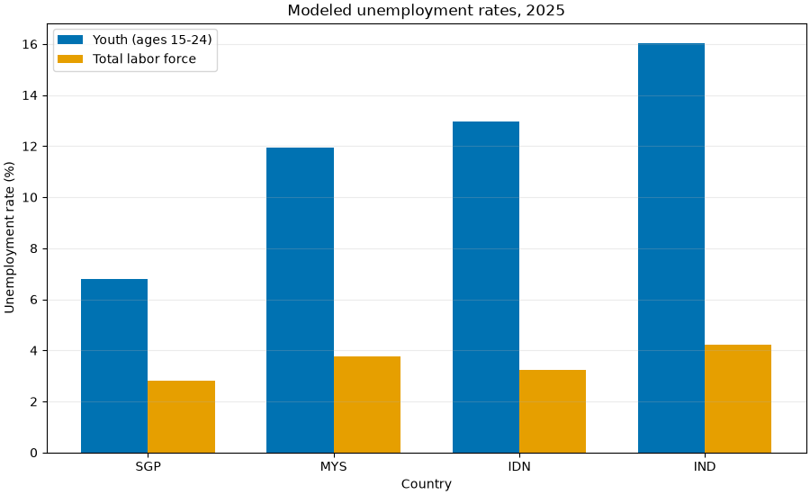

# Youth Employment Descriptive Analysis

Input snapshots: `wb-youth-unemployment-1524-2015-2025` (5d9da42f9cabafe5788093910dbff45c684cba9a1baad0d4cab993790b281085) and `wb-total-unemployment-2015-2025` (ff45778aa411adc612e8df5ae4856b63894c3c91e46c02b4be4e5e30709c722e).

## 1. Youth Unemployment Trends

**Question**: How did modeled youth unemployment change from 2015 to 2025 in the four selected countries?

The line chart shows the annual youth unemployment rate (% of the labor force ages 15-24). The endpoint table reports the percentage-point change; null endpoints remain unavailable.

| Country | Start rate (%) | End rate (%) | Change (percentage points) |
|---|---:|---:|---:|
| SGP | 8.9 | 6.8 | -2.1 |
| MYS | 11.0 | 12.0 | +1.0 |
| IDN | 17.2 | 13.0 | -4.2 |
| IND | 25.0 | 16.0 | -8.9 |

## 2. Youth and Total Unemployment in the Latest Year

**Question**: How do the two modeled rates compare in 2025?

The grouped bars show distinct indicators: youth unemployment uses the labor force ages 15-24, while total unemployment uses the total labor force. Their difference is descriptive only and is not a causal estimate.

| Country | Youth rate (%) | Total rate (%) | Difference (percentage points) |
|---|---:|---:|---:|
| SGP | 6.8 | 2.8 | +4.0 |
| MYS | 12.0 | 3.8 | +8.2 |
| IDN | 13.0 | 3.2 | +9.7 |
| IND | 16.0 | 4.2 | +11.8 |

## Caveats

Both series are modeled ILO estimates distributed by the World Bank and may be revised. The four countries are a selected comparison set, not a representative regional sample. The two rates have different labor-force denominators; do not interpret their difference as a causal effect or as the unemployment experience of the same population.

Reproduce with `make data-parse` followed by `make data-eda`. No values are imputed.
