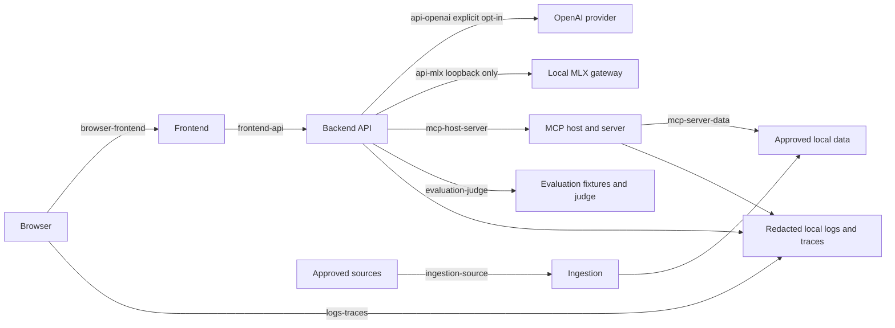

# Feature 008 Threat Model

## Scope

This is a local-assessment threat model. It maps observable controls and test evidence; it does not certify production hosting or claim prompt injection is solved. User input, source passages, model output, MCP descriptions/resources/results, and test artifacts are untrusted data.

## browser-frontend: Browser to frontend
- **Assets/data class**: UI state and public/synthetic query text; no provider credentials.
- **Principals/identity**: Local browser user; browser origin is not an authenticated identity.
- **Authorization**: Frontend has no direct corpus, provider, database, or MCP access.
- **Validation**: Typed API payloads and browser-side size checks; backend remains authoritative.
- **Logging/redaction**: No raw prompt telemetry or credentials in browser logs.
- **Failure behavior**: Display backend failure without exposing internal exception details.
- **Abuse cases**: Script injection, oversized input, accidental secret bundling.
- **Tests**: `apps/frontend/tests/security.test.ts`.
- **Residual risk**: No production authentication or browser security-header certification in local-only scope.

## frontend-api: Frontend to backend API
- **Assets/data class**: Query, filters, approved evidence, and typed response data.
- **Principals/identity**: Local frontend process to loopback API; no production user identity.
- **Authorization**: Backend derives permission scope and rejects caller attempts to elevate it.
- **Validation**: Pydantic request models, bounded request fields, typed response validation, host redaction of recognized prompt-injection clauses, and deterministic blocks for sensitive-data requests.
- **Logging/redaction**: Allow-listed request metadata only; query content is not logged by default.
- **Failure behavior**: Stable typed errors and safe terminal status; no implicit provider fallback.
- **Abuse cases**: Permission escalation, malformed requests, oversized request bodies, cancellation.
- **Tests**: `apps/backend/tests/security/test_security_boundaries.py`.
- **Residual risk**: Heuristic text detection can miss novel or obfuscated injection; reverse-proxy and public transport controls are not tested.

## api-openai: Backend to OpenAI provider
- **Assets/data class**: User query and selected evidence; potentially sensitive local context.
- **Principals/identity**: Backend and configured provider credential; credentials remain server-side.
- **Authorization**: External provider selection requires explicit opt-in; default is no external request.
- **Validation**: Provider-neutral request contract, output validation, timeouts, and bounded budgets.
- **Logging/redaction**: Secret values and raw prompts are excluded from default telemetry.
- **Failure behavior**: Fail safely; never switch providers implicitly.
- **Abuse cases**: Unapproved external fallback, credential leakage, provider response injection.
- **Tests**: `apps/backend/tests/security/test_provider_boundaries.py`.
- **Residual risk**: Provider-side retention and account controls are outside local test evidence.

## api-mlx: Backend to local MLX gateway
- **Assets/data class**: Query and evidence intended to stay on the local machine.
- **Principals/identity**: Backend to configured loopback MLX endpoint.
- **Authorization**: Endpoint must be loopback-only and provider must be explicitly selected.
- **Validation**: Typed action envelope, response validation, timeout, and finite token/tool budgets.
- **Logging/redaction**: Model content and credentials are not emitted in default traces.
- **Failure behavior**: Unavailable local gateway fails safely without OpenAI fallback.
- **Abuse cases**: Remote endpoint substitution, malformed output, oversized output, cancellation.
- **Tests**: `apps/backend/tests/security/test_provider_boundaries.py`.
- **Residual risk**: Host compromise and model artifact integrity are not certified.

## mcp-host-server: Backend MCP host to MCP server
- **Assets/data class**: Allow-listed read-only tool/resource calls and typed results.
- **Principals/identity**: Backend host validates configured server identity and version.
- **Authorization**: Explicit server, tool, and resource allow-lists; no generic shell, SQL, or URL tools.
- **Validation**: Strict arguments and result schemas, timeout, cancellation, call budgets.
- **Logging/redaction**: Allow-listed lifecycle metadata; arguments and results are not logged raw.
- **Failure behavior**: Stable error taxonomy; no retry beyond configured transient retry budget.
- **Abuse cases**: Unknown server, injected tool description, invalid arguments, timeout, exhaustion.
- **Tests**: `services/mcp-policy-data/tests/test_security_boundaries.py`.
- **Residual risk**: Production service identity and network isolation are not assessed.

## mcp-server-data: MCP server to local data
- **Assets/data class**: Approved public/synthetic structured rows and passage resources.
- **Principals/identity**: MCP server process; source identity comes from the validated catalog.
- **Authorization**: Read-only operations and source-specific usage permissions.
- **Validation**: Identifier/path traversal rejection, output limits, hashes, schema checks.
- **Logging/redaction**: Operation metadata only; raw arguments and source content are excluded.
- **Failure behavior**: Unknown or stale resources fail closed with stable errors.
- **Abuse cases**: Traversal identifiers, unauthorized source, malformed/oversized result, repeated calls.
- **Tests**: `services/mcp-policy-data/tests/test_security_boundaries.py`.
- **Residual risk**: Filesystem ownership and host-level isolation are not tested.

## ingestion-source: Approved source to ingestion pipeline
- **Assets/data class**: Public, synthetic, or approved anonymized source documents and structured data.
- **Principals/identity**: Maintainer and source publisher; source manifest records provenance and permission.
- **Authorization**: Rights status and allowed use are checked before ingestion or evaluation.
- **Validation**: Hash, parser schema, canonical identity, row/page anchors, and size checks.
- **Logging/redaction**: Manifests contain provenance metadata, not credentials or unnecessary source text.
- **Failure behavior**: Unknown, unapproved, or malformed sources are excluded and reported.
- **Abuse cases**: Poisoned source instructions, rights drift, malformed files, oversized documents.
- **Tests**: `scripts/tests/test_security_audit.py`; `apps/backend/tests/unit/test_indexing.py`.
- **Residual risk**: Source publisher authenticity and future rights changes require human review.

## evaluation-judge: Evaluation harness to case/result data
- **Assets/data class**: Synthetic attack payloads, approved evaluation cases, aggregate results.
- **Principals/identity**: Local maintainer and deterministic test runner; no external judge by default.
- **Authorization**: Evaluation source permissions and explicit provider opt-in are enforced separately.
- **Validation**: Strict fixture/result models, schema validation, case identity, secret scanning.
- **Logging/redaction**: Results store safe summaries and test references, not prompts or raw tool output.
- **Failure behavior**: Invalid or blocked records fail closed and remain distinguishable from passes.
- **Abuse cases**: Fixture contamination, fabricated pass, secret leakage, evaluation label injection.
- **Tests**: `scripts/tests/test_security_audit.py`; `scripts/tests/test_evaluation_suite.py`.
- **Residual risk**: Human approval and production deployment claims cannot be inferred from local tests.

## logs-traces: Services to local logs and traces
- **Assets/data class**: Allow-listed lifecycle, timing, error-code, and hash metadata.
- **Principals/identity**: Local service operators; local filesystem access is assumed.
- **Authorization**: No general user-content or provider-credential fields are accepted by telemetry models.
- **Validation**: Typed allow-lists and redaction checks before serialization.
- **Logging/redaction**: Secret-shaped values, prompts, model output, and raw MCP payloads are excluded.
- **Failure behavior**: Logging failure does not disclose payloads or alter authorization decisions.
- **Abuse cases**: Token/password leakage, PII in traces, exception text echo, bundle contamination.
- **Tests**: `apps/backend/tests/unit/test_logging.py`; `services/mcp-policy-data/tests/test_logging.py`; `scripts/tests/test_security_audit.py`.
- **Residual risk**: Host log access, backup retention, and deletion are operator responsibilities.

## STRIDE Summary

| Threat | Local controls and evidence | Residual risk |
|---|---|---|
| Spoofing | Configured provider/server identity and loopback MLX checks | Production identity infrastructure is out of scope |
| Tampering | Typed schemas, source hashes, catalog validation, and fail-closed parsing | Host and source publisher compromise are not certified |
| Repudiation | Append-only manifests and safe test references | No production audit identity or centralized immutable store |
| Information disclosure | Secret redaction, no frontend credentials, explicit provider opt-in | External provider retention is governed outside this repository |
| Denial of service | Request/result limits, timeouts, cancellation, and call budgets | Deployment-level capacity testing is not performed |
| Elevation of privilege | Permission-scope validation and allow-listed read-only tools | Production authentication and multi-tenant authorization are not in scope |

Attack coverage is specific to the listed fixtures and test paths. Prompt injection is not solved or generally prevented by these checks.